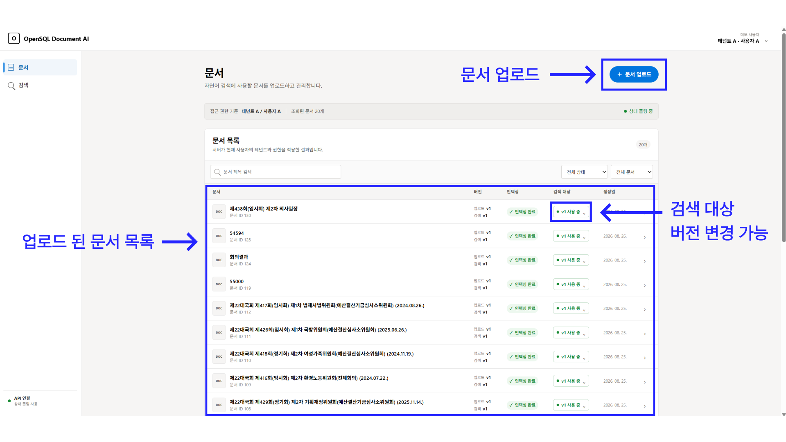
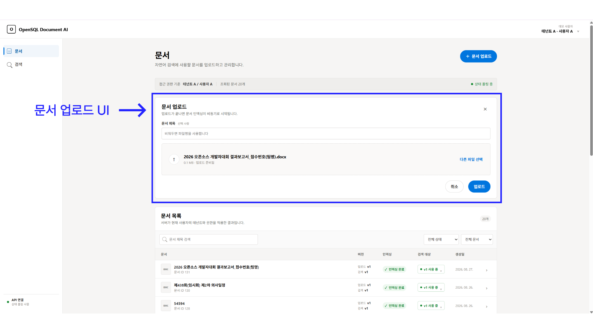
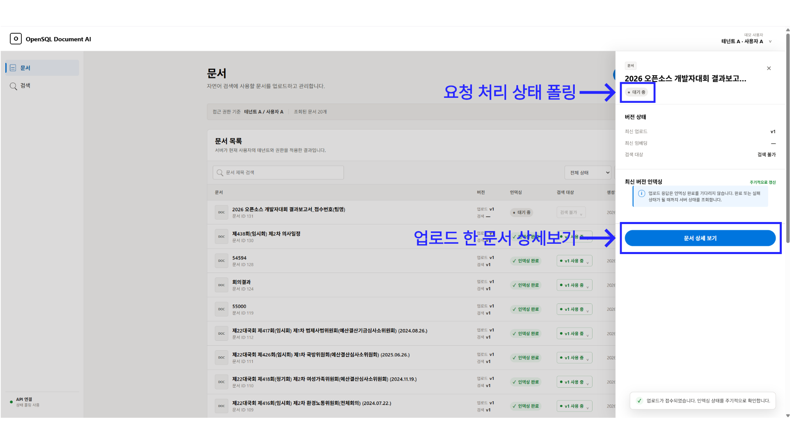
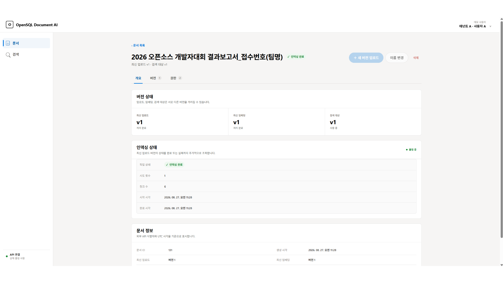
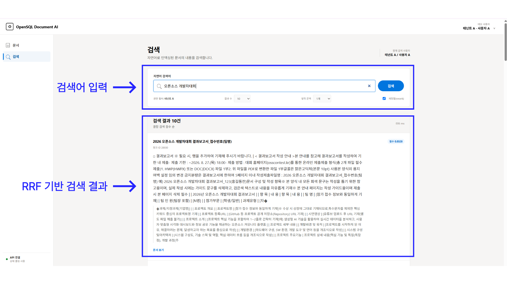

# OpenSQL Document AI

## 프로젝트 소개

OpenSQL Document AI는 문서를 업로드해 인덱싱 상태와 버전을 관리하고, 인덱싱된 문서 내용을 자연어로 검색하는 데모 웹 애플리케이션입니다. 데모 사용자를 바꿔 사용자·테넌트별 문서 접근 범위와 권한에 따른 화면 동작을 확인할 수 있습니다. 화면의 문서와 검색 결과는 연결된 API에서 가져옵니다.



## 주요 기능

- **데모 사용자 선택**: 사용자 A, B, C(테넌트 A)와 사용자 D(테넌트 B)를 전환하고 선택한 사용자의 권한으로 문서 목록과 검색 결과를 조회합니다.
- **문서 업로드 및 관리**: PDF, DOCX, Markdown, HWP, TXT 파일을 최대 20MB까지 업로드하며, 제목 변경과 문서 삭제를 지원합니다.
- **문서 목록 및 상태 확인**: 제목, 인덱싱 상태, 검색 가능 여부로 문서를 필터링하고 다음 페이지를 불러올 수 있습니다. 진행 중인 인덱싱 상태는 완료 또는 실패까지 주기적으로 갱신되며, 처리 단계, 다음 재시도 시각, 마지막 오류 코드와 메시지를 함께 보여 줍니다.
- **문서 버전 관리**: 새 버전 업로드(같은 내용이 이전 버전에 있으면 중복 버전을 표시), 버전별 인덱싱 정보와 메타데이터 확인, 원본 다운로드, 실패한 인덱싱 재시도, 검색 대상 버전 변경을 지원합니다.
- **접근 권한 관리**: 문서에 대한 사용자·테넌트 단위의 읽기·쓰기·관리 권한을 확인하고, 소유자 또는 관리(ADMIN) 권한이 있으면 권한을 부여·변경·회수할 수 있습니다.
- **자연어 문서 검색**: 결과 수와 앞뒤 문맥 범위, 재정렬(rerank) 사용 여부를 지정해 검색하고, 결과의 점수·페이지·섹션·본문 문맥을 확인한 뒤 원본 문서 상세로 이동할 수 있습니다. 재정렬은 기본으로 켜져 있으며, 정확도가 오르는 대신 응답이 느려질 수 있습니다.
- **DB 장애 전환 대응**: 서버가 DB 장애 전환 중에 `503`과 `Retry-After`를 응답하면, 조회와 검색은 최대 45초까지 자동으로 다시 요청하고 화면에 안내를 표시합니다. 쓰기 요청은 반영됐을 수 있어 다시 보내지 않습니다.

## 사용 방법

1. **문서를 업로드합니다.**
   왼쪽의 `문서` 메뉴에서 `문서 업로드`를 누르고 파일을 선택하거나 끌어다 놓습니다. 제목은 선택 사항이며 비워 두면 파일명이 사용됩니다.

   

2. **인덱싱 상태를 확인합니다.**
   문서 목록에서 `대기 중`, `처리 중`, `재시도 대기`, `인덱싱 완료`, `실패` 상태를 확인합니다. 처리 중인 문서는 3초 간격으로 상태가 갱신됩니다. 목록은 제목, 상태, 검색 가능 여부로 필터링할 수 있습니다.

   

3. **문서와 버전을 관리합니다.**
   목록의 문서를 선택하면 요약이 열리고, `문서 상세 보기`에서 개요·버전·권한을 확인할 수 있습니다. 쓰기 권한이 있는 사용자는 새 버전 업로드, 이름 변경, 삭제, 실패한 버전 재시도, 완료된 버전의 검색 대상 지정을 수행할 수 있습니다. 접근 권한 관리는 소유자 또는 ADMIN에게 허용됩니다.

   

4. **문서 내용을 검색합니다.**
   왼쪽의 `검색` 메뉴에서 자연어 검색어를 입력하고 결과 수, 앞뒤 문맥 개수, 재정렬 사용 여부를 선택합니다. 검색 결과에서 관련 내용, 점수, 페이지와 섹션 정보를 확인하고 `문서 보기`를 눌러 해당 문서 상세로 이동합니다.

   

## 실행 방법

### 요구 환경

- Node.js 22 이상 (`package.json`의 `engines` 기준)
- npm
- 문서 관리 및 검색 API: 같은 origin에서 제공하거나 아래 환경변수로 주소를 지정해야 합니다.

### 의존성 설치

저장소 루트에서 잠금 파일을 기준으로 의존성을 설치합니다.

```bash
npm ci
```

### 환경변수 설정

API가 웹과 다른 origin에서 실행된다면 `.env.example`을 프로젝트 루트의 `.env.local`로 복사(또는 새로 생성)하고 API 주소를 설정합니다.

```dotenv
VITE_API_BASE_URL=http://localhost:8080
```

같은 origin에서 API를 제공하는 경우 이 설정을 생략할 수 있습니다.

### 개발 서버 실행

```bash
npm run dev
```

터미널에 표시된 로컬 주소로 접속합니다.

### 빌드 및 미리보기

```bash
npm run build
npm run preview
```

빌드 결과는 `dist/`에 생성됩니다.

## 환경 변수

| 변수 | 설명 | 필수 여부 |
| --- | --- | --- |
| `VITE_API_BASE_URL` | 문서·검색 API의 base URL입니다. 마지막 `/`는 자동으로 제거되며, 설정하지 않으면 현재 웹 origin으로 요청합니다. | 조건부 — API가 다른 origin일 때 필요 |

모든 API 요청에는 화면에서 선택한 데모 사용자의 ID가 `X-User-Id` 헤더로 자동 전달됩니다.

## 기술 스택

| 영역 | 기술 |
| --- | --- |
| UI | React |
| 언어 | TypeScript |
| 개발 서버·빌드 | Vite, `@vitejs/plugin-react` |
| API 통신 | Fetch API, FormData, Blob |
| 스타일링 | CSS |

## API 권한 응답

문서 목록·상세 응답의 `effectivePermission` (`READ`, `WRITE`, `ADMIN`)으로 편집 가능 여부를 판단합니다. 권한 목록은 ADMIN에게만 허용되므로, 목록 조회 실패를 문서 쓰기 권한 없음으로 해석하지 않습니다. `ownerPrincipalId`는 소유자 권한 회수 방지에 사용합니다. 이 두 필드를 제공하는 서버 변경을 먼저 반영해야 합니다.

권한별 화면 회귀 검증은 의존성 설치 후 `node scripts/check-permissions.mjs`로, 인덱싱 상태 표시 검증은 `node scripts/check-indexing.mjs`로 실행합니다.

## 관련 문서

- [API 명세](api-design.md): 이 웹 앱이 사용하는 서버 API 계약
- [API–UI 연동 가이드](API_UI_INTEGRATION_GUIDE.md): 화면별 API 사용 방식과 에러 처리

## 라이선스

이 프로젝트는 MIT 라이선스를 따릅니다. 자세한 내용은 [LICENSE](LICENSE)를 참고하세요.

### 사용된 오픈소스

| 프로젝트 | 라이선스 |
|---|---|
| React / React DOM | MIT |
| Vite / @vitejs/plugin-react | MIT |
| TypeScript | Apache-2.0 |
