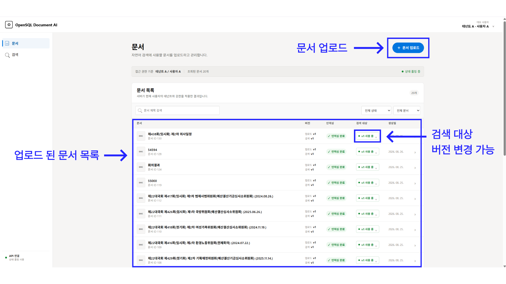
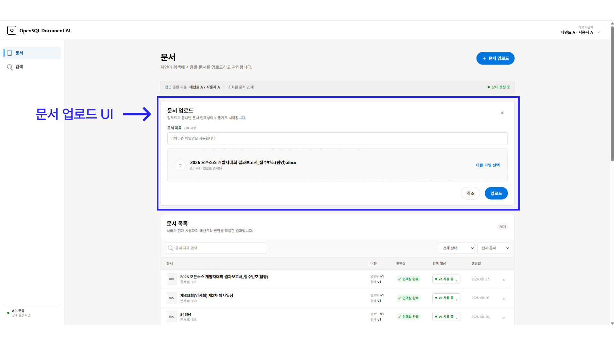
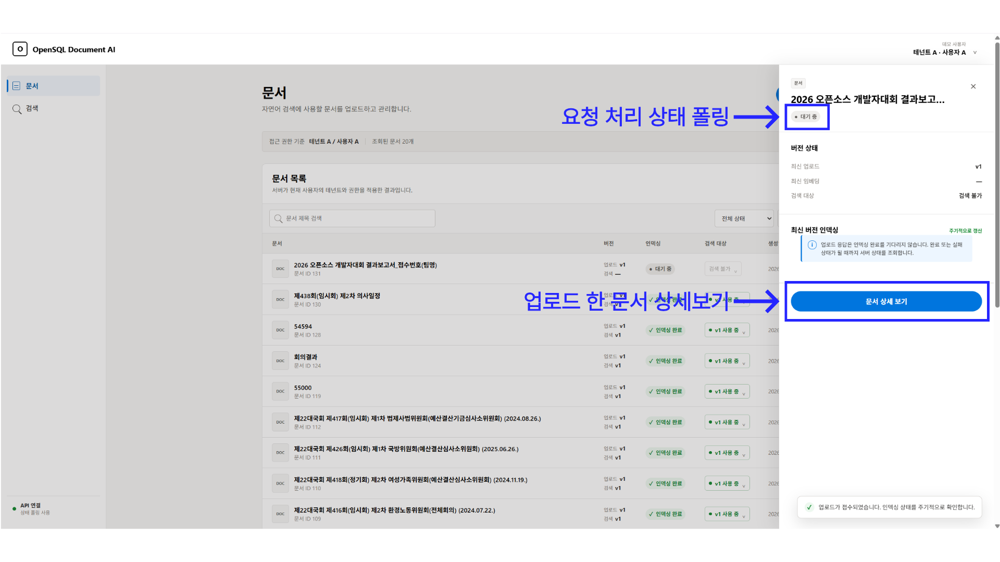
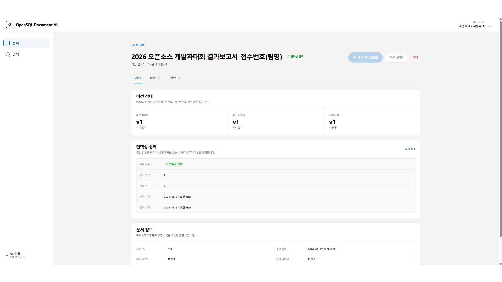
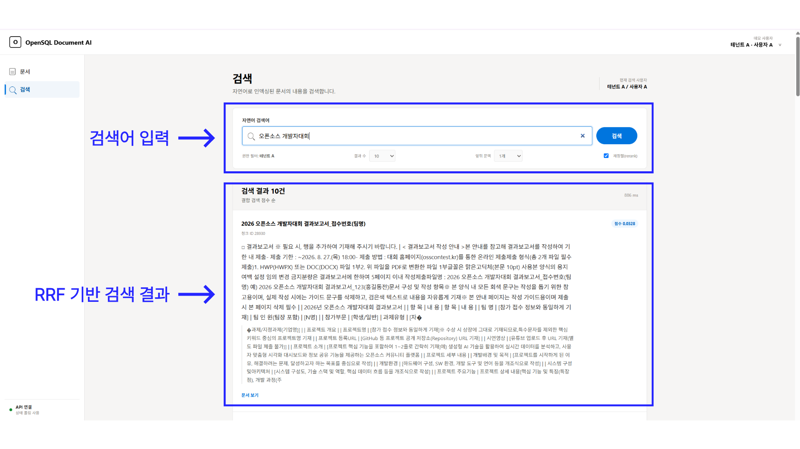

[한국어](README.md) | [English](README_EN.md)

# OpenSQL Document AI

## Overview

OpenSQL Document AI is a demo web application for uploading documents, managing their indexing status and versions, and searching the indexed content in natural language. You can switch demo users to see how document access scope and screen behavior change by user, tenant, and permission. The documents and search results on screen come from the connected API.



## Key features

- **Demo user selection**: Switch between users A, B, C (tenant A) and user D (tenant B), and browse documents and search results with the selected user's permissions.
- **Document upload and management**: Upload PDF, DOCX, Markdown, HWP, and TXT files up to 20MB, rename documents, and delete them.
- **Document list and status**: Filter documents by title, indexing status, and searchability, and load the next page. Indexing in progress is refreshed periodically until it completes or fails, and the list shows the processing phase, the next retry time, and the last error code and message.
- **Document versions**: Upload a new version (a duplicate version is flagged when the same content exists in an earlier version), view per-version indexing details and metadata, download the original, retry failed indexing, and change the search target version.
- **Access control**: View read, write, and admin permissions per user and tenant. Owners and users with ADMIN permission can grant, change, and revoke permissions.
- **Natural language search**: Set the number of results, the surrounding context range, and whether to rerank, then check each result's score, page, section, and body context and jump to the source document. Reranking is on by default; it improves accuracy but can slow the response.
- **DB failover handling**: When the server responds with `503` and `Retry-After` during a DB failover, reads and searches are retried automatically for up to 45 seconds and a notice is shown. Write requests are not resent because they may already have been applied.

## How to use

1. **Upload a document.**
   Press `문서 업로드` (Upload document) in the `문서` (Documents) menu on the left, then choose or drag in a file. The title is optional; the file name is used when it is left blank.

   

2. **Check the indexing status.**
   In the document list, check the status: `대기 중` (pending), `처리 중` (processing), `재시도 대기` (waiting to retry), `인덱싱 완료` (indexed), or `실패` (failed). Documents being processed are refreshed every 3 seconds. The list can be filtered by title, status, and searchability.

   

3. **Manage documents and versions.**
   Select a document in the list to open its summary, then use `문서 상세 보기` (View document details) to see the overview, versions, and permissions. Users with write permission can upload a new version, rename or delete the document, retry a failed version, and set a completed version as the search target. Access management is allowed for the owner or ADMIN.

   

4. **Search document content.**
   Enter a natural language query in the `검색` (Search) menu on the left and choose the number of results, the number of surrounding context chunks, and whether to rerank. Check the related content, score, page, and section in each result, then press `문서 보기` (View document) to go to that document's details.

   

## Running

### Requirements

- Node.js 22 or later (per `engines` in `package.json`)
- npm
- The document management and search API: serve it from the same origin, or set its address with the environment variable below.

### Install dependencies

Install dependencies from the repository root, based on the lock file.

```bash
npm ci
```

### Set environment variables

If the API runs on a different origin from the web app, copy `.env.example` to `.env.local` in the project root (or create it) and set the API address.

```dotenv
VITE_API_BASE_URL=http://localhost:8080
```

You can skip this setting when the API is served from the same origin.

### Start the development server

```bash
npm run dev
```

Open the local address shown in the terminal.

### Build and preview

```bash
npm run build
npm run preview
```

The build output is generated in `dist/`.

## Environment variables

| Variable | Description | Required |
| --- | --- | --- |
| `VITE_API_BASE_URL` | Base URL of the document and search API. A trailing `/` is removed automatically. If unset, requests go to the current web origin. | Conditional: needed when the API is on a different origin |

Every API request automatically carries the selected demo user's ID in the `X-User-Id` header.

## Tech stack

| Area | Technology |
| --- | --- |
| UI | React |
| Language | TypeScript |
| Dev server and build | Vite, `@vitejs/plugin-react` |
| API communication | Fetch API, FormData, Blob |
| Styling | CSS |

## API permission responses

Editability is decided by `effectivePermission` (`READ`, `WRITE`, `ADMIN`) in the document list and detail responses. The permission list is allowed only for ADMIN, so a failed list request is not interpreted as having no write permission on the document. `ownerPrincipalId` is used to prevent revoking the owner's permission. The server change that provides these two fields must be applied first.

Run the per-permission screen regression check with `node scripts/check-permissions.mjs` after installing dependencies, and the indexing status display check with `node scripts/check-indexing.mjs`.

## Related documents

- [API specification](api-design_EN.md): The server API contract this web app uses
- [API–UI integration guide](API_UI_INTEGRATION_GUIDE_EN.md): How each screen uses the API, and error handling
- [Contributing guide](CONTRIBUTING_EN.md): Issue, branch, commit, and PR procedure
- [Code conventions](docs/CODE_CONVENTIONS_EN.md): Standards for comments, readability, structure, and failure handling
- [Security policy](SECURITY_EN.md): How to report vulnerabilities privately

## License

This project is licensed under the MIT License. See [LICENSE](LICENSE) for details.

### Open source used

| Project | License |
|---|---|
| React / React DOM | MIT |
| Vite / @vitejs/plugin-react | MIT |
| TypeScript | Apache-2.0 |
